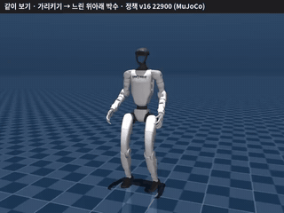
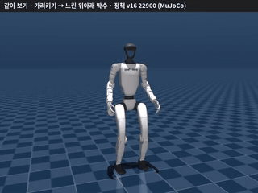
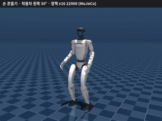
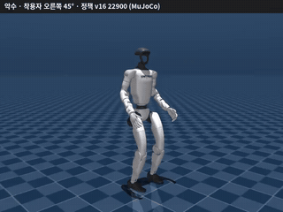
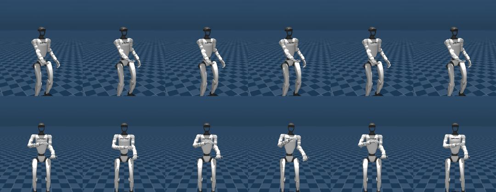
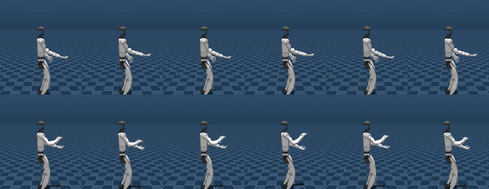
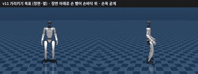
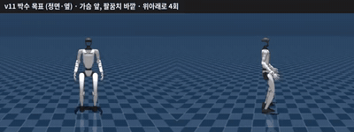
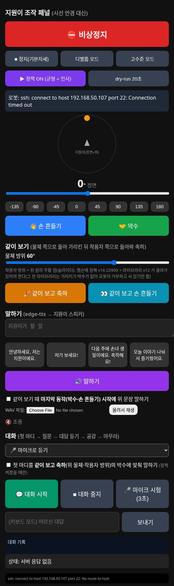
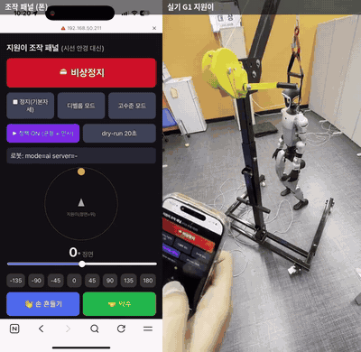

# 지원이(G1) 데모2 — 최종 모션 패키지

> MoLBWA 데모2 · 시선 안경으로 G1 휴머노이드 "지원이"와 교감하기
> 최종 정책 **v16 22900** + 모션 라이브러리 **v12** · 2026-10-20 정리

이 폴더 하나만 있으면 지원이의 최종 동작을 **시뮬레이터로 돌려 보거나 실기(젯슨)에 올릴 수 있습니다.**
정책 하나로 아래 동작을 모두 합니다.

- 가만히 서 있기 (밀어도 버티기)
- 착용자 쪽으로 돌아서기 (15° 간격, 23방향)
- 👋 손 흔들기 · 🤝 악수
- 👀 **같이 보기**: 물건 쪽으로 돌아 손바닥을 위로 해서 가리킴 → 착용자 쪽으로 돌아와 박수

웹 조작 패널에는 **말하기**(지원이 스피커)와 **CLOVA 대화**도 들어 있습니다.

> ⚠️ 아래 영상과 수치는 모두 **MuJoCo 시뮬레이터** 결과입니다. 정책 v16 22900 은 **아직 실기에서 돌려 보지 않았습니다.**
> 실기 검증이 끝난 것은 이전 정책 18400(회전·손 흔들기·악수)뿐입니다 → [실기 기록](#지난-실기-기록-2026-10-12)

---

## 목차
1. [이 폴더에 든 것](#이-폴더에-든-것)
2. [동작 영상](#동작-영상-정책-v16-22900-시뮬)
3. [왜 이 정책인가 (관문 결과)](#왜-22900-인가-관문-결과)
4. [가리키기·박수를 다시 만든 이유](#가리키기박수를-다시-만든-이유)
5. [웹 패널 · 말하기 · 대화](#웹-패널--말하기--대화)
6. [시뮬레이터로 돌려 보기](#시뮬레이터로-돌려-보기)
7. [실기(젯슨)에 올리기](#실기젯슨에-올리기)
8. [아직 확인 안 된 것](#아직-확인-안-된-것)

---

## 이 폴더에 든 것

| 파일 | 크기 | md5 | 설명 |
|---|---|---|---|
| `policy_v16_22900.npz` | 1.0 MB | `86c7aab7c06865bf8bb2d279a50a3aa3` | 최종 정책 (numpy 로 젯슨에서 바로 돎). **학습 결과라 다시 만들 수 없음** |
| `molbwa_library12.npz` | 12.6 MB | `ac5ede3c5a15fe35bee1bfcd24817fd9` | 모션 라이브러리 v12 (정책이 따라가는 참조 동작) |
| `library_meta.json` | 3 KB | `c3b03e5aa61a1a6cf8f5deea602ae237` | 라이브러리 세그먼트 표: `idle` · `wave` · `handshake` · `point` · `celebrate` + 회전 23개 |
| `upload_jetson.sh` | — | — | 젯슨에 한 번에 올리고 md5 대조 (로봇 명령 없음) |
| `media/` | — | — | 이 README 의 그림·GIF |

- 라이브러리는 `g1/tools/build_library_v12.sh` 로 다시 만들 수 있습니다 (Isaac Lab 변환 필요).
- CLOVA 키 파일(`~/.config/molbwa/clova.env`)은 **절대 커밋하지 않습니다.** 만드는 법은 [대화](#대화-clova) 참고.

---

## 동작 영상 (정책 v16 22900, 시뮬)

### 같이 보기 — 가리키기 → 박수

| 물체 왼쪽 60° / 착용자 오른쪽 30° | 물체 오른쪽 45° / 착용자 왼쪽 90° |
|---|---|
|  |  |
| 방향 오차 6.5° · 끝까지 서 있음 | 방향 오차 6.5° · 끝까지 서 있음 |

*GIF 는 1.5배속입니다.* 물건 쪽으로 돌아 → 손바닥을 위로 하고 탁자 높이를 가리킨 뒤 → 착용자 쪽으로 돌아와 → 한 손은 아래에서 받치고 한 손은 위에서 내려치는 박수를 3번 칩니다.

### 손 흔들기 · 악수

| 👋 손 흔들기 (착용자 왼쪽 30°) | 🤝 악수 (착용자 오른쪽 45°) |
|---|---|
|  |  |
| 방향 오차 4.0° · 동작 후 3초 포함 | 방향 오차 0.9° · 동작 후 3초 포함 |

### 목표 자세 vs 정책이 실제로 한 자세 (같은 순간)

각 칸 **왼쪽 = 목표, 오른쪽 = 정책 실제**. 윗줄 가리키기, 아랫줄 박수 (동작 진행 30·50·70% 시점).




가리키기는 정면 아래로 곧게, 박수는 두 팔뚝이 가슴 앞에 수평으로 포개집니다.

> **아직 부족한 점:** 박수 때 아래(왼)손 손바닥이 목표의 약 70% 까지만 돕니다 (손목 회전 목표 −62°, 실제 −43°). 완전히 하늘을 보지는 않습니다.

---

## 왜 22900 인가 (관문 결과)

학습 중 저장된 체크포인트마다 똑같은 시험을 돌려 **모든 관문을 통과한 것 중 가장 좋은 것**을 골랐습니다.
시험 = 방향 6개 × (손 흔들기·악수) + 같이 보기 3장면, MuJoCo.

| 정책 | 동작 후 떨림<br>(≤ 0.05) | 400 N 밀기 | 같이 보기 | 동작 중 머리 흔들림 | 가리키기 오차 | 박수 오차 | 판정 |
|---|---|---|---|---|---|---|---|
| 21300 (이전) | 0.02 | 버팀 | 3/3 | 1.85 cm | 8.8°\* | 21.9°\* | 모양이 어색 |
| v15 22300 | 0.01 | 버팀 | 3/3 | 2.42 cm | 3.5° | 10.0° | 통과 |
| v15 22799 | 0.01 | ❌ 토크 가드 | 3/3 | 2.22 cm | 3.4° | 6.7° | 탈락 |
| v16 22500 | 0.01 | 버팀 | 3/3 | 2.37 cm | — | 11.4° | 통과 |
| v16 22700 | 0.02 | 버팀 | 3/3 | 2.75 cm | — | 9.8° | 통과 |
| **v16 22900** | **0.01** | **버팀 (144 cm)** | **3/3** | **1.54 cm** | **3.7°** | **7.7°** | ✅ **채택** |
| v16 23100 | ❌ 0.45 | 버팀 | 3/3 | 2.08 cm | — | 7.2° | 탈락 |
| v16 23299 | ❌ 0.87 | 버팀 | 3/3 | 1.99 cm | 3.3° | 7.6° | 탈락 |

- **동작 후 떨림** = 동작이 끝나고 서 있을 때 머리 가속도(m/s²). 0.05 를 넘으면 눈에 보이게 떨립니다.
- **400 N 밀기** = 0.2초 동안 한 번 세게 밀기. 토크 가드(1초 평균 60%)가 걸리면 실기에서 관절이 풀려 주저앉을 수 있어 탈락입니다. 괄호는 밀려난 거리.
- **오차** = 팔 관절이 목표에서 평균 몇 도 벗어났나.
- \* 21300 은 예전(어색한) 목표 동작 기준이라 아래 줄들과 같은 잣대가 아닙니다. — 는 따로 뽑지 않은 값.

---

## 가리키기·박수를 다시 만든 이유

처음 학습한 21300 은 관문은 통과했지만 **"가리키기·박수가 이상하다"** 는 지적을 받았습니다.
같은 순간의 목표와 실제 자세를 나란히 그려 보니, 정책이 못 따라간 게 아니라 **목표 동작 자체가 어색**했습니다.

- 가리키기: 팔이 몸을 가로지르고 손목이 꺾여 '좀비 팔'
- 박수: 팔을 52 cm 앞으로 쭉 뻗어 쟁반 든 모양

그래서 목표를 손 위치·손바닥 방향 IK(`g1/motion/hand_ik.py`)로 처음부터 다시 만들었습니다.

| 새 가리키기 목표 | 새 박수 목표 |
|---|---|
|  |  |
| 어깨에서 정면 30° 아래로 58 cm, 손바닥 위, 손목 곧게 · 올림 1.2 s · 유지 2.5 s · 내림 1.2 s | 가슴 앞 38 cm, 팔꿈치 바깥으로. 최종 v12 는 이 모양을 **초당 1회·3번**으로 늦춤 (GIF 는 늦추기 전 4번) |

박수가 빠르면(초당 1.6회) 정책이 못 따라가 손이 처져서, v12 에서 늦춘 뒤 이어서 학습한 것이 v16 22900 입니다.

---

## 웹 패널 · 말하기 · 대화



데스크탑에서 띄우고 휴대폰 브라우저로 엽니다. 시선 안경 대신 각도와 동작을 골라 보낼 수 있습니다.

- **⛔ 비상정지 · ■ 정지 · 디벨롭/고수준 모드 · ▶ 정책 ON · dry-run**
- 착용자 방위 고르기 → **👋 손 흔들기 / 🤝 악수**
- 물체 방위 고르기 → **🎉 같이 보고 축하 / 👀 같이 보고 손 흔들기**
- **🔊 말하기**: 문장을 입력하거나 자주 쓰는 문장 버튼 → 지원이 스피커로
  - "같이 보기 때 마지막 동작(박수) 시작에 위 문장 말하기" 체크 → 박수 치는 순간에 맞춰 말함
  - WAV 파일을 올려 재생할 수도 있음
- **💬 대화**: 아래 2턴 대화를 시작·중지, 🎤 마이크 3초 시험, 대화 기록 표시

<br clear="right">

### 말하기 — 소리가 가는 길

| 상황 | 경로 | 이유 |
|---|---|---|
| 정책이 **켜져 있을 때** | 패널 → 모션 서버(UDP `say`) → 서버 안에서 1초씩 잘라 재생 | 젯슨에서 다른 프로그램이 로봇 통신을 새로 열면 제어 주기가 깨져 **정책이 멈춥니다** (2026-10-12 실기에서 겪음) |
| 정책이 **꺼져 있을 때** | 패널 → 젯슨 `~/g1_play_pcm` 직접 재생 | 대화 팀이 실기 확인한 재생기. 모션 서버가 떠 있으면 스스로 거부 |

패널이 정책 상태를 보고 **자동으로** 길을 고릅니다. 목소리는 무료 **edge-tts** (Microsoft `ko-KR-InJoonNeural`, 속도 −10%).
`--tts clova` 로 띄우면 CLOVA Voice 로 바뀌지만 **월 기본요금 90,000원** 이 붙습니다.

### 대화 (CLOVA)

정해진 2턴 대본입니다. AI 가 만든 말은 두 군데뿐이라 틀릴 위험이 적습니다.

| 순서 | 누가 | 예 (실제 생성 결과) |
|---|---|---|
| 1 첫 마디 | CLOVA **HCX-005** 생성 | "어르신, 11월 3일에 손녀 지은이의 생일이 있지요. 그날까지 이제 17일밖에 남지 않았어요." |
| 2 질문 | 고정 | "그날 뭘 해 주고 싶으세요?" |
| 3 대답 | 마이크 → CLOVA **음성 인식(CSR)** 또는 패널에 입력 | "미역국 끓여 주고 싶어" |
| 4 공감 | CLOVA **HCX-005** 생성 | "어르신께서 직접 미역국을 끓여 주시고 싶다니, 지은이는 세상에서 가장 행복한 아이네요!" |
| 5 마무리 | 고정 | "오늘 이야기 나눠서 즐거웠어요." |

- 1 과 4 는 서로 다른 시험에서 나온 문장입니다. 걸린 시간: 생성 0.6~1.1 초, 음성 인식 0.8 초.
- 클라우드가 4초 넘게 늦거나, 키가 없거나, 금지 표현(약·병원·돈·정치·기억력 시험)이 나오면 **미리 써 둔 문장으로 이어 갑니다.** 시연이 끊기지 않습니다.
- 성별을 짐작하지 않고 "어르신"이라고 부릅니다. 가족 일정은 `g1/dialog_memory.json` (시연용 가상 가족).
- 첫 마디를 '같이 보고 축하'의 박수에 맞춰 말하게 할 수도 있습니다 (정책 켜졌을 때).

**키 파일 만들기** — 리포 밖, 본인만 읽을 수 있게:

```bash
mkdir -p ~/.config/molbwa
nano ~/.config/molbwa/clova.env      # 아래 세 줄
chmod 600 ~/.config/molbwa/clova.env
```
```
CLOVA_STUDIO_API_KEY=nv-...     # CLOVA Studio → API 키 → 테스트 API 키 발급
NCP_CLIENT_ID=...               # 콘솔 → AI·NAVER API → Application 등록(CSR 만 체크) → 인증 정보
NCP_CLIENT_SECRET=...
```
> CLOVA Voice - Premium 은 체크하지 마세요 (쓰지 않아도 월 9만 원). Application 등록 후 [수정]에서 CSR 이 선택돼 있는지 확인하세요 (안 돼 있으면 429 오류).

**마이크:** G1 내장 마이크는 지금 신호가 나오지 않습니다 (15초 동안 0패킷 — 유니트리 앱의 '깨우기 대화 모드'가 필요한 것으로 보이는데 앱 베타가 만료됨). **핀마이크를 데스크탑에 꽂아** 패널의 🎤 마이크 시험으로 확인하세요. 마이크가 없으면 대화를 "⌨ 대답을 여기 입력" 모드로 쓰면 됩니다.

---

## 시뮬레이터로 돌려 보기

리포 최상위에서 (MuJoCo 창 + 패널):

```bash
POLICY=$PWD/motion/policy_v16_22900.npz \
MOTION=$PWD/motion/molbwa_library12.npz \
META=$PWD/motion/library_meta.json \
bash g1/tools/sim_panel.sh
```
브라우저에서 `http://localhost:8080` → 방위를 고르고 버튼을 누르면 됩니다. 창 없이 돌리려면 앞에 `VIEWER=` 를 붙이세요.

필요한 것: `g1deploy` conda 환경(mujoco·numpy), 말하기는 edge-tts (`python3 -m venv ~/.venvs/g1_dialog && ~/.venvs/g1_dialog/bin/pip install edge-tts`)와 ffmpeg.

---

## 실기(젯슨)에 올리기

1. **젯슨을 켜고, 정책이 꺼진 상태에서** 올립니다. 모션 서버·스피커 코드·정책·라이브러리가 함께 가고 md5 를 대조합니다.
   ```bash
   bash motion/upload_jetson.sh 192.168.50.107
   ```
2. 데스크탑에서 패널을 띄웁니다.
   ```bash
   cd g1 && python3 g1_panel.py --jetson 192.168.50.107 --ssh unitree@192.168.50.107 --port 8080
   ```
   휴대폰으로 `http://<데스크탑 IP>:8080`
3. **dry-run 20초** → 제어 주기·에러 확인 (모터 명령 안 나감)
4. **하네스 + 비상정지 담당 + 주변 2 m** 확인 → **디벨롭 모드** → **▶ 정책 ON**
5. 하나씩: 손 흔들기·악수 → 같이 보기 → (정책 켠 채) 말하기 한 문장 → 대화

> **정책이 켜진 동안에는 소리를 패널로만 보내세요.** 젯슨에서 `g1_play_pcm` 같은 프로그램을 따로 실행하면 정책이 멈출 수 있습니다.
> 더 자세한 운용·안전 수칙은 [`g1/RUNBOOK.md`](../g1/RUNBOOK.md) 8장.

### 지난 실기 기록 (2026-10-12)



*이전 정책 18400 · 왼쪽 휴대폰 패널, 오른쪽 실기 (102초 영상 중 15초).* 패널로 각도를 골라 회전·손 흔들기·악수를 했고, 이후 **하네스 없이 서기와 서서 밀기 시험도 통과**했습니다 (사용자 보고). 이때 겪은 문제와 고친 것:

| 증상 | 원인 | 조치 |
|---|---|---|
| 정책 ON 직후 손 흔들기가 안 먹음 | 패널이 3초마다 젯슨에서 로봇 통신을 새로 열어 제어 주기가 튐 | 정책 중엔 상태 조회 안 함 + 10초 간격 |
| 6분쯤 뒤 갑자기 멈춤 | numpy 가 8스레드로 돌며 제어 주기가 가끔 86 ms | numpy 1스레드 고정 (최대 36 → 20 ms) |
| 서버 로그가 사라짐 | 매번 같은 파일에 덮어씀 | 런마다 `~/molbwa_g1/logs/` 에 따로 남김 |

---

## 아직 확인 안 된 것

| 항목 | 상태 |
|---|---|
| 정책 v16 22900 의 실기 동작 | 🟡 시뮬에서만 확인 |
| 정책 켠 상태에서 말하기 (모션 서버 안 재생, 제어 주기 영향) | 🟡 실기 전 |
| 로봇 스피커 소리가 실제로 들렸는지 (재생 응답 0 만 확인) | 🟡 확인 필요 |
| 마이크로 듣는 대화 (음성 인식은 합성 음성으로만 확인) | 🟡 마이크 필요 |
| G1 내장 마이크 | 🔴 신호 없음 (앱 설정 필요로 보임) |
| 박수 아래 손 손바닥 회전 (목표의 약 70%) | 🟡 개선 여지 |

---

<sub>관련 코드: 정책 서버 `g1/deploy/g1_motion_server.py` · 패널 `g1/g1_panel.py` · 대화 `g1/g1_dialog.py` · 목소리 `g1/g1_tts.py` · 말 보내기 `g1/g1_say.py` · 목표 동작 IK `g1/motion/hand_ik.py` · 라이브러리 빌드 `g1/tools/build_library_v12.sh`</sub>
